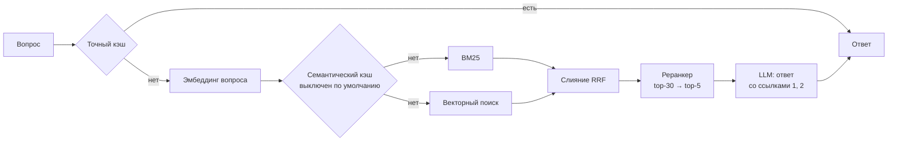
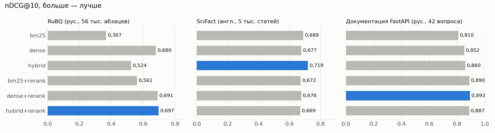
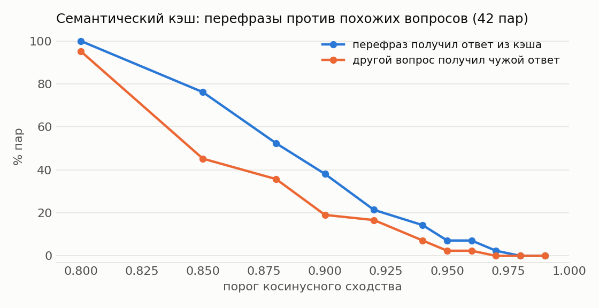

# rag-template — RAG для продакшена, где каждое решение проверено замерами

[](https://github.com/sofetizm/rag-template/actions/workflows/ci.yml)
[](https://colab.research.google.com/github/sofetizm/rag-template/blob/main/notebooks/benchmark_colab.ipynb)


Шаблон вопросно-ответной системы по документам, который запускается одной командой. В нём есть
гибридный поиск (BM25 + векторы), реранкер, ответы со ссылками на источники, кэш,
трассировка с ценой каждого запроса и проверка качества в CI. Каждый компонент проверен на трёх
наборах данных — включая случаи, где он вредит.

Демо — ассистент по русской документации FastAPI: 121 страница, 1 479 фрагментов.

## Быстрый старт

```bash
git clone https://github.com/sofetizm/rag-template.git && cd rag-template
cp .env.example .env          # впишите GROQ_API_KEY (бесплатный ключ: console.groq.com)
docker compose up --build
```

Откройте http://localhost:8000. При первом запуске сервис сам проиндексирует демо-документацию.
Описание API — на http://localhost:8000/docs.

## Как устроен ответ на вопрос



| Шаг | Что делает | Почему так |
|---|---|---|
| Нарезка | Markdown режется по заголовкам; в каждый фрагмент добавляется путь «страница — раздел», ссылка ведёт на якорь раздела | Фрагмент без заголовка теряет смысл; пользователь попадает сразу в нужный раздел |
| BM25 | Хранится в Qdrant как разреженные векторы, IDF считает сам Qdrant | Индекс обновляется по одному документу, без пересборки; формула совпадает с эталонной BM25 (тест `test_bm25_scores_match_reference_formula`) |
| Векторы | `intfloat/multilingual-e5-small` с префиксами `query:` / `passage:` | Быстрая модель для CPU; русский и английский |
| Слияние | Reciprocal Rank Fusion, k = 60 | Не нужно приводить к одной шкале несравнимые оценки BM25 и косинуса. Но если один поиск намного слабее, слияние тянет результат вниз (см. RuBQ ниже) |
| Реранкер | Кросс-энкодер `mmarco-mMiniLMv2-L12` по 30 кандидатам | Читает вопрос и фрагмент вместе: точнее, но медленнее, поэтому только для короткого списка |
| Ответ | Фрагменты пронумерованы, модель обязана ставить ссылки [n] и отвечать фиксированной фразой, если ответа нет | Ответ можно проверить; отказ распознаётся программно и не выдаётся за ответ |
| Кэш | Ключ включает версию индекса и настройки поиска; после переиндексации старые ответы не возвращаются | Кэш не отдаёт устаревших ответов. Семантический кэш выключен: замер показал, что он путает похожие вопросы |
| Трассировка | Длительность каждого шага, токены и цена в долларах — в ответе API, в JSONL-логе и в метриках Prometheus (`/metrics`) | Видно, где тратится время и деньги |

## Результаты

Числа посчитаны ноутбуком [`notebooks/benchmark_colab.ipynb`](notebooks/benchmark_colab.ipynb)
(Colab, GPU T4). Все таблицы, интервалы и сырые ответы — в [`results/`](results/RESULTS.md).

### Поиск: универсального победителя нет

Метрика — nDCG@10. Разницы проверены парным бутстрепом по запросам (95% ДИ).

| Конфигурация | RuBQ (рус., 56 826 абзацев, 1 692 вопроса) | SciFact (англ., 5 183 статьи, 300 вопросов) | Документация FastAPI (рус., 84 вопроса) |
|---|---|---|---|
| bm25 | 0,367 | 0,689 | 0,810 |
| dense | 0,680 | 0,677 | 0,852 |
| hybrid | 0,524 | **0,719** | 0,860 |
| bm25+rerank | 0,561 | 0,672 | 0,890 |
| dense+rerank | 0,691 | 0,676 | **0,893** |
| hybrid+rerank | **0,697** | 0,669 | 0,887 |



1. **Гибридный поиск не всегда лучше.** На RuBQ BM25 почти вдвое слабее векторов, и слияние
   с равными весами тянет результат вниз: hybrid хуже dense на 0,156 (ДИ −0,171 … −0,142).
   На SciFact, где оба поиска сильные, гибрид лучший: +0,042 к dense (ДИ +0,016 … +0,069).
2. **Реранкер помогает на русском и вредит на английских научных статьях.** На RuBQ он
   поднимает гибрид на 0,173 (ДИ +0,159 … +0,187), на документации FastAPI все варианты с
   реранкером лучше BM25 на ~0,08. На SciFact тот же реранкер ухудшает гибрид на 0,050
   (ДИ −0,077 … −0,023): модель обучена на веб-запросах mMARCO, а не на научных текстах.
3. **На документации FastAPI** нужная страница в первых пяти фрагментах для 98,8% вопросов
   при любой конфигурации с реранкером; различия между ними в пределах шума.

По умолчанию стоит `hybrid+rerank`: на русских данных он лучший или наравне с лучшим и не
проваливается, когда один из поисков слабый. Для другого домена проверьте конфигурации на своих
данных — это одна команда `rag eval retrieval`.

### Ответы целиком

LLM `gpt-oss-20b`, судья `gpt-oss-120b`; 42 вопроса с ответом в документации и 8 без него.
В скобках — 95% доверительный интервал.

| | только BM25 | hybrid + реранкер |
|---|---|---|
| Верных ответов | 83% (69–92%) | **98%** (88–100%) |
| Без выдумок (всё подтверждается фрагментами) | 92% (80–97%) | 95% (84–99%) |
| Ложный отказ, хотя ответ есть | 7% | **0%** |
| Отказ, когда ответа в документации нет | 100% | 100% |
| Ссылка на нужную страницу | 92% | 93% |
| Цена за 1 000 ответов | $0,13 | $0,14 |

Поиск с реранкером добавляет ~0,33 с (из них реранкер 0,31 с на T4); основное время занимает
LLM — 6–10 с в зависимости от нагрузки на Groq.

### Семантический кэш опасен

Семантический кэш отдаёт сохранённый ответ, если новый вопрос «похож» на старый. Для каждого из
42 вопросов я проверила перефраз (ответ должен совпасть) и похожий по словам, но другой вопрос
(ответ должен быть другим), например «Как сделать query-параметр обязательным?» и «…необязательным?».

| Порог сходства | Перефраз получил ответ из кэша | Другой вопрос получил **чужой** ответ |
|---|---|---|
| 0,85 | 76% | 45% |
| 0,90 | 38% | 19% |
| 0,95 | 7% | 2% |
| 0,97 | 2% | 0% |



Сходство перефразов (в среднем 0,888) и разных вопросов (0,859, максимум 0,962) почти не
различается. Порог без ошибок (0,97) почти не даёт попаданий, а при пороге 0,90 каждый пятый
похожий вопрос получает чужой ответ. Поэтому семантический кэш выключен по умолчанию; точный
кэш (с нормализацией текста вопроса) включён.

## Свои документы

```bash
pip install -e ".[ml]"
docker compose up -d qdrant
export RAG_QDRANT_URL=http://localhost:6333
rag ingest ./my-docs --base-url https://docs.example.com/   # .md .txt .rst .html .pdf
rag ask "Как настроить авторизацию?"
rag serve
```

Повторный `rag ingest` переиндексирует только изменившиеся файлы (сравнивается хэш), `--prune`
удаляет из индекса файлы, которых больше нет. Файлы можно загрузить и через API: `POST /ingest`.

Чтобы в Docker вместо демо загрузились ваши документы, положите их в `data/` и укажите путь в `.env`:
`RAG_INGEST_ON_START=data/my-docs`.

LLM подключается через любой OpenAI-совместимый API: Groq (по умолчанию), OpenAI, OpenRouter, vLLM,
Ollama. Пример для локальной Ollama:

```bash
RAG_LLM_BASE_URL=http://host.docker.internal:11434/v1
RAG_LLM_MODEL=qwen2.5:7b
RAG_LLM_EXTRA={}
```

## API

| Метод | Что делает |
|---|---|
| `POST /ask` | ответ, источники, номера процитированных фрагментов, трассировка |
| `POST /ask/stream` | то же потоком (Server-Sent Events): сначала источники, потом текст |
| `POST /search` | только поиск, без LLM |
| `POST /ingest` | загрузить и проиндексировать файлы |
| `GET /health` | число документов и фрагментов, версия индекса |
| `GET /metrics` | метрики Prometheus: время шагов, токены, стоимость, попадания в кэш |

```bash
curl -s localhost:8000/ask -H 'Content-Type: application/json' \
  -d '{"question": "Как вернуть ошибку 404?", "mode": "hybrid", "rerank": true}'
```

Если задан `RAG_API_KEY`, запросы должны передавать заголовок `X-API-Key`.
`docker compose --profile monitoring up` дополнительно поднимает Prometheus на http://localhost:9090.

## Проверка качества

Эталонный набор [`data/golden/fastapi_ru.jsonl`](data/golden/fastapi_ru.jsonl): 42 вопроса с
эталонными ответами и страницами-источниками, к каждому — перефраз и похожий по словам, но другой
вопрос, плюс 8 вопросов, ответа на которые в документации нет.

```bash
rag eval retrieval --gate eval/gate.yaml   # метрики поиска; код возврата 1, если ниже порогов
rag eval cache                             # семантический кэш: перефразы против похожих вопросов
rag eval answers                           # ответы целиком, оценивает LLM-судья
rag eval benchmark --dataset mteb/RuBQRetrieval
```

В CI на каждый коммит:
1. тесты, в том числе на настоящем сервере Qdrant;
2. индексация демо настоящими моделями и **проверка порогов** из [`eval/gate.yaml`](eval/gate.yaml):
   изменение, которое ухудшает поиск, не пройдёт;
3. сборка Docker-образа, запуск всего стека и проверочные запросы.

Оценка ответов через LLM запускается вручную (Actions → Answer evaluation), потому что тратит
токены; нужен секрет `GROQ_API_KEY`.

## Настройки

Все настройки — переменные окружения с префиксом `RAG_` (полный список в
[`config.py`](src/rag_template/config.py), примеры в [`.env.example`](.env.example)).

| Переменная | По умолчанию | |
|---|---|---|
| `RAG_RETRIEVAL_MODE` | `hybrid` | `bm25`, `dense`, `hybrid` |
| `RAG_RERANK` | `true` | реранкер |
| `RAG_TOP_K` | `5` | сколько фрагментов отдавать LLM |
| `RAG_CHUNK_SIZE` | `1000` | размер фрагмента в символах |
| `RAG_EMBEDDING_MODEL` | `intfloat/multilingual-e5-small` | |
| `RAG_RERANKER_MODEL` | `cross-encoder/mmarco-mMiniLMv2-L12-H384-v1` | |
| `RAG_LLM_MODEL` | `openai/gpt-oss-20b` | |
| `RAG_CACHE_BACKEND` | `memory` | `redis` в Docker, `none` |
| `RAG_SEMANTIC_CACHE` | `false` | включайте после `rag eval cache` |
| `RAG_MIN_RERANK_SCORE` | — | ниже этой оценки реранкера LLM не вызывается, сразу отказ |

## Структура

```
src/rag_template/
  documents.py   нарезка Markdown по заголовкам
  loaders.py     md, txt, rst, html, pdf
  models.py      эмбеддинги, реранкер, BM25 как разреженные векторы
  store.py       Qdrant и инкрементальная индексация
  retriever.py   BM25 / векторы / гибрид, RRF, реранкинг
  pipeline.py    промпт, ссылки на источники, отказы, кэш
  cache.py       точный кэш (память, Redis) и семантический кэш (Qdrant)
  tracing.py     трассировка, цена запроса, метрики Prometheus
  llm.py         OpenAI-совместимый клиент с повторами и стримингом
  api.py         FastAPI + веб-интерфейс (static/index.html)
  cli.py         rag ingest / ask / search / serve / eval
  eval/          метрики поиска, бенчмарки BEIR/MTEB, кэш, LLM-судья
data/demo/       русская документация FastAPI (MIT)
data/golden/     эталонные вопросы
eval/gate.yaml   пороги качества для CI
notebooks/       замеры в Colab
scripts/         подготовка демо, отчёт с графиками
```

## Разработка

```bash
pip install -e ".[dev,ml]"
pytest                    # тесты без скачивания моделей: хэш-эмбеддинги и маленькая локальная модель
RAG_TEST_QDRANT_URL=http://localhost:6333 pytest tests/test_qdrant_server.py
```

## Ограничения

- BM25 считается по средней длине фрагмента на момент первой индексации. Если корпус сильно
  изменился, пересоберите индекс: `rag ingest ... --rebuild`.
- Встроенный режим Qdrant (без сервера) подходит для тестов и небольших корпусов: на 20 тысячах
  фрагментов поиск BM25 в нём занимает ~200 мс против ~6 мс на сервере.
- Модели загружаются в каждый процесс uvicorn: при нескольких воркерах растёт расход памяти.
- Эталонный набор небольшой (42 вопроса), поэтому интервалы на нём широкие; выводы о
  компонентах поиска опираются в первую очередь на открытые бенчмарки.
- Слияние RRF с равными весами; на корпусах, где BM25 заметно слабее векторов, лучше взвешенное
  слияние или `RAG_RETRIEVAL_MODE=dense` с реранкером — проверьте на своих данных.
- Реранкер дорог на CPU: 30 пар занимают ~0,3 с на GPU T4 и ~3,6 с в Docker на CPU (GitHub Actions).
  Без GPU уменьшите `RAG_RERANK_TOP` или возьмите реранкер меньше.

## Лицензия

MIT. Демо-корпус — русская документация [FastAPI](https://github.com/fastapi/fastapi)
(© Sebastián Ramírez, MIT), см. [`data/demo/fastapi-ru/NOTICE`](data/demo/fastapi-ru/NOTICE).
