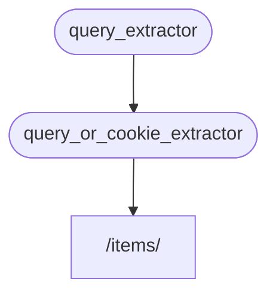

# Подзависимости { #sub-dependencies }

Вы можете создавать зависимости, которые имеют **подзависимости**.

Их **вложенность** может быть любой глубины.

**FastAPI** сам займётся их разрешением.

## Первая «зависимость» { #first-dependency-dependable }

Можно создать первую «зависимость» следующим образом:

```python
from typing import Annotated

from fastapi import Cookie, Depends, FastAPI

app = FastAPI()

def query_extractor(q: str | None = None):
    return q

def query_or_cookie_extractor(
    q: Annotated[str, Depends(query_extractor)],
    last_query: Annotated[str | None, Cookie()] = None,
):
    if not q:
        return last_query
    return q

@app.get("/items/")
async def read_query(
    query_or_default: Annotated[str, Depends(query_or_cookie_extractor)],
):
    return {"q_or_cookie": query_or_default}
```

Она объявляет необязательный параметр запроса `q` как `str`, а затем возвращает его.

Это довольно просто (хотя и не очень полезно), но поможет нам сосредоточиться на том, как работают подзависимости.

## Вторая зависимость, «зависимость» и «зависимая» { #second-dependency-dependable-and-dependant }

Затем можно создать еще одну функцию зависимости, которая одновременно объявляет свою собственную зависимость (таким образом, она тоже является «зависимой»):

```python
from typing import Annotated

from fastapi import Cookie, Depends, FastAPI

app = FastAPI()

def query_extractor(q: str | None = None):
    return q

def query_or_cookie_extractor(
    q: Annotated[str, Depends(query_extractor)],
    last_query: Annotated[str | None, Cookie()] = None,
):
    if not q:
        return last_query
    return q

@app.get("/items/")
async def read_query(
    query_or_default: Annotated[str, Depends(query_or_cookie_extractor)],
):
    return {"q_or_cookie": query_or_default}
```

Остановимся на объявленных параметрах:

* Несмотря на то, что эта функция сама является зависимостью, она также объявляет другую зависимость (она «зависит» от чего-то другого).
    * Она зависит от `query_extractor` и присваивает возвращаемое ей значение параметру `q`.
* Она также объявляет необязательный куки-параметр `last_query` типа `str`.
    * Если пользователь не указал параметр `q` в запросе, то мы используем последний использованный запрос, который мы ранее сохранили в cookie.

## Использование зависимости { #use-the-dependency }

Затем мы можем использовать зависимость следующим образом:

```python
from typing import Annotated

from fastapi import Cookie, Depends, FastAPI

app = FastAPI()

def query_extractor(q: str | None = None):
    return q

def query_or_cookie_extractor(
    q: Annotated[str, Depends(query_extractor)],
    last_query: Annotated[str | None, Cookie()] = None,
):
    if not q:
        return last_query
    return q

@app.get("/items/")
async def read_query(
    query_or_default: Annotated[str, Depends(query_or_cookie_extractor)],
):
    return {"q_or_cookie": query_or_default}
```

**Примечание:**

Обратите внимание, что мы объявляем только одну зависимость в *функции-обработчике пути* - `query_or_cookie_extractor`.

Но **FastAPI** будет знать, что сначала он должен выполнить `query_extractor`, чтобы передать результаты этого в `query_or_cookie_extractor` при его вызове.



## Использование одной и той же зависимости несколько раз { #using-the-same-dependency-multiple-times }

Если одна из ваших зависимостей объявлена несколько раз для одной и той же *операции пути*, например, несколько зависимостей имеют общую подзависимость, **FastAPI** будет знать, что вызывать эту подзависимость нужно только один раз за HTTP-запрос.

При этом возвращаемое значение будет сохранено в «кэш» и будет передано всем "зависимым" функциям, которые нуждаются в нем внутри этого конкретного HTTP-запроса, вместо того, чтобы вызывать зависимость несколько раз для одного и того же HTTP-запроса.

В расширенном сценарии, когда вы знаете, что вам нужно, чтобы зависимость вызывалась на каждом шаге (возможно, несколько раз) в одном и том же HTTP-запросе, вместо использования "кэшированного" значения, вы можете установить параметр `use_cache=False` при использовании `Depends`:

**Python 3.10+:**

```python
async def needy_dependency(
    fresh_value: Annotated[str, Depends(get_value, use_cache=False)],
):
    return {"fresh_value": fresh_value}
```

**Python 3.10+ без Annotated:**

**Подсказка:**

Предпочтительнее использовать версию с `Annotated`, если это возможно.

```python
async def needy_dependency(fresh_value: str = Depends(get_value, use_cache=False)):
    return {"fresh_value": fresh_value}
```

## Резюме { #recap }

Помимо всех этих умных слов, используемых здесь, система **внедрения зависимостей** довольно проста.

Это просто функции, которые выглядят так же, как *функции-обработчики путей*.

Но, тем не менее, эта система очень мощная и позволяет вам объявлять вложенные графы (деревья) зависимостей сколь угодно глубоко.

**Подсказка:**

Все это может показаться не столь полезным на этих простых примерах.

Но вы увидите, как это пригодится в главах, посвященных **безопасности**.

И вы также увидите, сколько кода это вам сэкономит.
