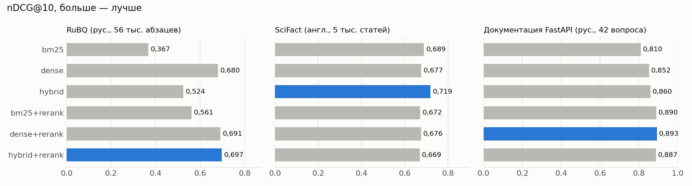
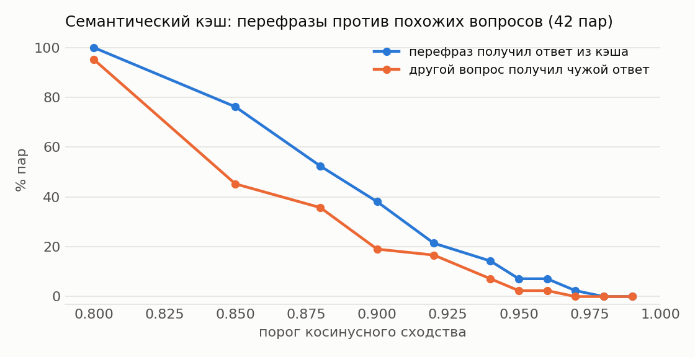

# Результаты

## RuBQ (рус., 56 тыс. абзацев)

Эмбеддинги: `intfloat/multilingual-e5-small`, реранкер: `cross-encoder/mmarco-mMiniLMv2-L12-H384-v1`, запросов: 1692.

| Конфигурация | ndcg@10 | recall@5 | recall@10 | mrr@10 | hit@1 | hit@5 |
|---|---|---|---|---|---|---|
| bm25 | 0.367 | 0.403 | 0.522 | 0.365 | 0.245 | 0.531 |
| dense | 0.680 | 0.713 | 0.803 | 0.702 | **0.603** | 0.830 |
| hybrid | 0.524 | 0.575 | 0.715 | 0.514 | 0.373 | 0.704 |
| bm25+rerank | 0.561 | 0.599 | 0.644 | 0.594 | 0.505 | 0.717 |
| dense+rerank | 0.691 | 0.729 | 0.824 | 0.702 | 0.596 | 0.840 |
| hybrid+rerank | **0.697** | **0.745** | **0.834** | **0.705** | 0.599 | **0.852** |

Разница nDCG@10 (парный бутстреп по запросам, 95% ДИ):

| Сравнение | Δ | 95% ДИ |
|---|---|---|
| dense vs bm25 | +0.313 | [+0.295; +0.332] |
| hybrid vs bm25 | +0.157 | [+0.147; +0.167] |
| bm25+rerank vs bm25 | +0.194 | [+0.180; +0.208] |
| dense+rerank vs bm25 | +0.324 | [+0.306; +0.341] |
| hybrid+rerank vs bm25 | +0.330 | [+0.314; +0.346] |
| hybrid+rerank vs hybrid | +0.173 | [+0.159; +0.187] |
| hybrid vs dense | -0.156 | [-0.171; -0.142] |

## SciFact (англ., 5 тыс. статей)

Эмбеддинги: `intfloat/multilingual-e5-small`, реранкер: `cross-encoder/mmarco-mMiniLMv2-L12-H384-v1`, запросов: 300.

| Конфигурация | ndcg@10 | recall@5 | recall@10 | mrr@10 | hit@1 | hit@5 |
|---|---|---|---|---|---|---|
| bm25 | 0.689 | 0.741 | 0.828 | 0.652 | 0.553 | 0.760 |
| dense | 0.677 | 0.734 | 0.807 | 0.645 | 0.557 | 0.757 |
| hybrid | **0.719** | **0.777** | **0.835** | **0.690** | **0.607** | **0.797** |
| bm25+rerank | 0.672 | 0.716 | 0.774 | 0.646 | 0.580 | 0.737 |
| dense+rerank | 0.676 | 0.719 | 0.782 | 0.650 | 0.580 | 0.743 |
| hybrid+rerank | 0.669 | 0.719 | 0.774 | 0.642 | 0.570 | 0.740 |

Разница nDCG@10 (парный бутстреп по запросам, 95% ДИ):

| Сравнение | Δ | 95% ДИ |
|---|---|---|
| dense vs bm25 | -0.012 | [-0.047; +0.023] |
| hybrid vs bm25 | +0.030 | [+0.010; +0.049] |
| bm25+rerank vs bm25 | -0.018 | [-0.047; +0.012] |
| dense+rerank vs bm25 | -0.013 | [-0.043; +0.016] |
| hybrid+rerank vs bm25 | -0.020 | [-0.049; +0.009] |
| hybrid+rerank vs hybrid | -0.050 | [-0.077; -0.023] |
| hybrid vs dense | +0.042 | [+0.016; +0.069] |

## Документация FastAPI (рус., 42 вопроса)

Эмбеддинги: `intfloat/multilingual-e5-small`, реранкер: `cross-encoder/mmarco-mMiniLMv2-L12-H384-v1`, запросов: 84.

| Конфигурация | ndcg@10 | recall@5 | recall@10 | mrr@10 | hit@1 | hit@5 |
|---|---|---|---|---|---|---|
| bm25 | 0.810 | 0.940 | 0.976 | 0.755 | 0.595 | 0.940 |
| dense | 0.852 | 0.964 | 0.976 | 0.811 | 0.702 | 0.964 |
| hybrid | 0.860 | 0.964 | **0.988** | 0.817 | 0.702 | 0.964 |
| bm25+rerank | 0.890 | **0.988** | **0.988** | 0.858 | **0.774** | **0.988** |
| dense+rerank | **0.893** | **0.988** | **0.988** | **0.861** | 0.762 | **0.988** |
| hybrid+rerank | 0.887 | **0.988** | **0.988** | 0.853 | 0.750 | **0.988** |

Разница nDCG@10 (парный бутстреп по запросам, 95% ДИ):

| Сравнение | Δ | 95% ДИ |
|---|---|---|
| dense vs bm25 | +0.042 | [-0.014; +0.099] |
| hybrid vs bm25 | +0.050 | [+0.008; +0.093] |
| bm25+rerank vs bm25 | +0.080 | [+0.023; +0.139] |
| dense+rerank vs bm25 | +0.083 | [+0.025; +0.142] |
| hybrid+rerank vs bm25 | +0.077 | [+0.019; +0.137] |
| hybrid+rerank vs hybrid | +0.027 | [-0.026; +0.082] |
| hybrid vs dense | +0.008 | [-0.032; +0.045] |

## Семантический кэш

Эмбеддинги: `intfloat/multilingual-e5-small`.

| Порог | Перефразы из кэша | Чужой ответ из кэша |
|---|---|---|
| 0.80 | 100% | 95% |
| 0.85 | 76% | 45% |
| 0.88 | 52% | 36% |
| 0.90 | 38% | 19% |
| 0.92 | 21% | 17% |
| 0.94 | 14% | 7% |
| 0.95 | 7% | 2% |
| 0.96 | 7% | 2% |
| 0.97 | 2% | 0% |
| 0.98 | 0% | 0% |
| 0.99 | 0% | 0% |

Минимальный порог без чужих ответов: 0.97.

## Ответы целиком (LLM-судья)

| Конфигурация | Верных ответов | Без выдумок | Отказ, где ответ есть | Отказ, где ответа нет | Цитата из нужного документа | p50, мс | $ за 1000 ответов |
|---|---|---|---|---|---|---|---|
| bm25 | 83% (69%–92%) | 92% (80%–97%) | 7% (2%–19%) | 100% (68%–100%) | 92% (80%–97%) | 5969 | 0.13 |
| hybrid+rerank | 98% (88%–100%) | 95% (84%–99%) | 0% (0%–8%) | 100% (68%–100%) | 93% (81%–98%) | 9981 | 0.14 |
